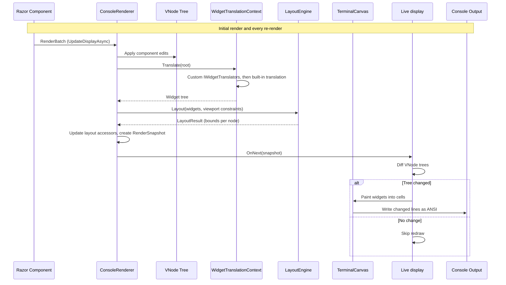
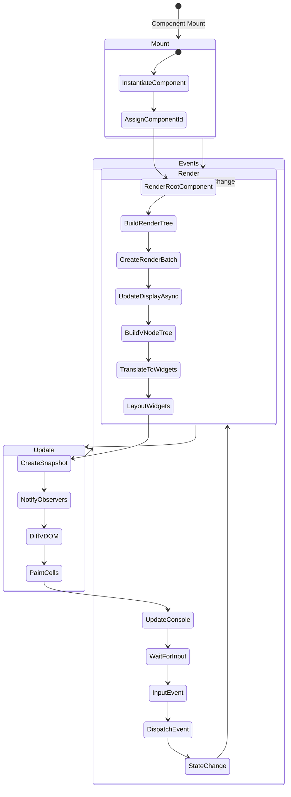
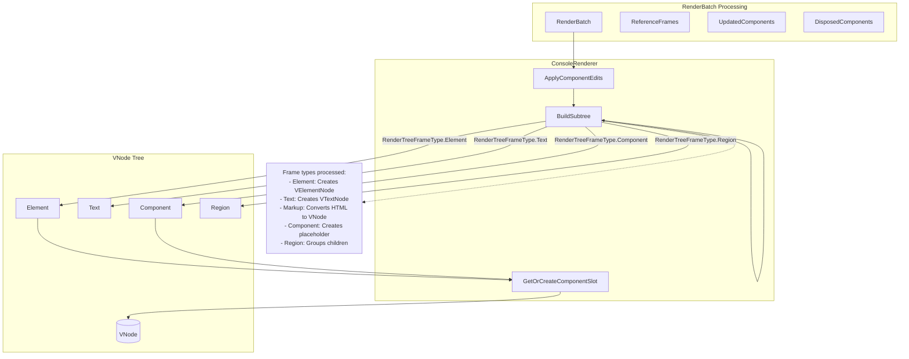
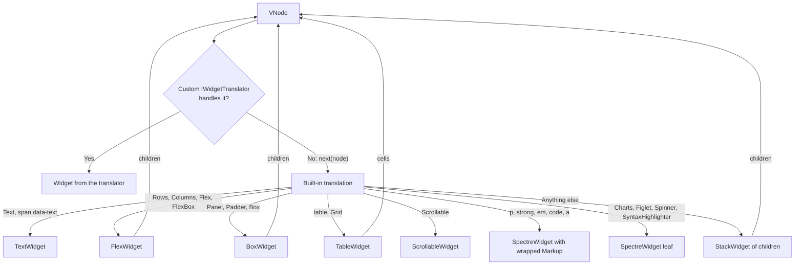
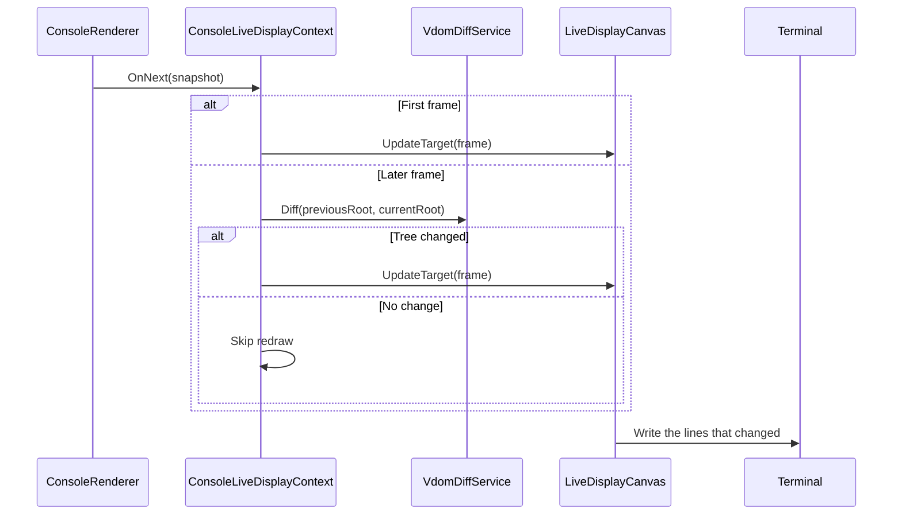
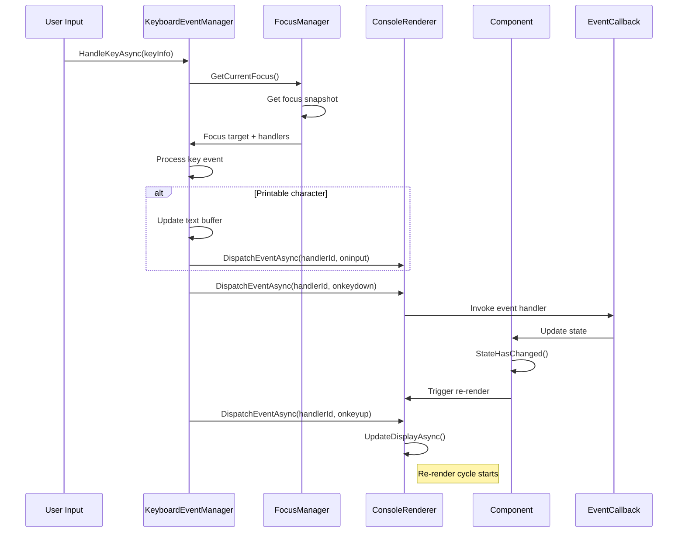

# Rendering Process

This document describes the rendering pipeline in RazorConsole, from Razor component to console output.

## Overview

RazorConsole converts Razor components into console output in these stages:

1. **Component Rendering**: Blazor renders Razor components into a `RenderBatch`.
2. **VDOM Construction**: `ConsoleRenderer` applies the batch to a `VNode` tree.
3. **Widget Translation**: `WidgetTranslationContext` translates the `VNode` tree into a `Widget` tree, running registered `IWidgetTranslator`s before the built-in translation.
4. **Layout**: `LayoutEngine` measures and arranges the widgets within the terminal viewport and records the bounds of every node.
5. **Paint**: the laid-out widgets paint into a `TerminalCanvas` of terminal cells; absolute-positioned widgets paint last, in `z-index` order.
6. **Console Output**: the live display writes the frame through Spectre.Console as ANSI escape sequences.

Before 1.0 there was also a legacy pipeline that translated `VNode`s straight to Spectre.Console `IRenderable`s through `ITranslationMiddleware`. It could not report element bounds and was removed in 1.0.

## Complete Rendering Flow

## Component Lifecycle

## VDOM Construction Process

## Widget Translation

Translators run for every node, including children of built-in containers, because containers translate their children through the same `WidgetTranslationContext.Translate`. Animated renderables found while translating, such as spinners, are collected so the live display can refresh them on their interval. See [custom-translators.md](custom-translators.md).

## Layout and Paint

`LayoutEngine.Layout` measures the widget tree against the viewport constraints, arranges every widget into a `LayoutRect`, and grows the document to fit absolute-positioned widgets. The resulting `LayoutResult` provides:

- the layout box of every node, which feeds `IVNodeLayoutAccessor`, focus and mouse hit-testing, and the diagnostics endpoint;
- `PaintToRenderable()`, which paints the widgets into a `TerminalCanvas` when the frame is written.

`SpectreWidget` leaves render their Spectre.Console renderable at the width they were given and copy the resulting segments into the canvas cells, so Spectre-backed content takes part in layout like any other widget.

## Update Process

A terminal resize refreshes the snapshot through the same path, so the frame is laid out again at the new size. Issue #425 plans to make the painted cell grid the pipeline's official output, with terminal, headless and diagnostics backends consuming the same frames.

## Event Handling and Re-render

