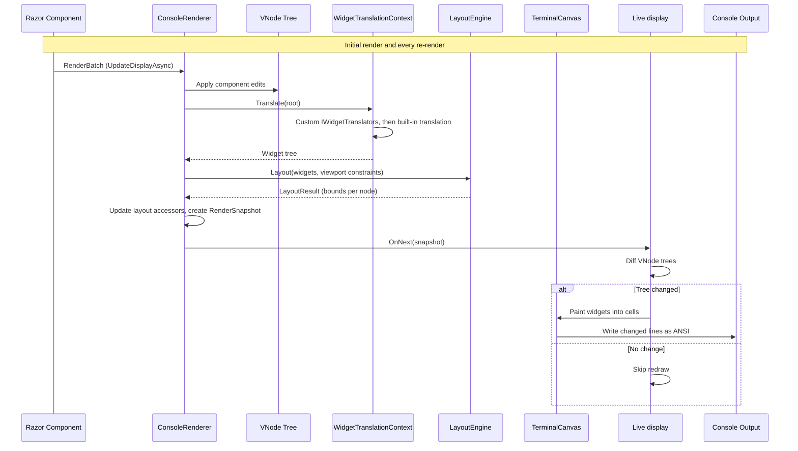
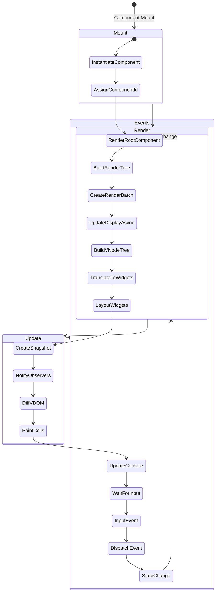
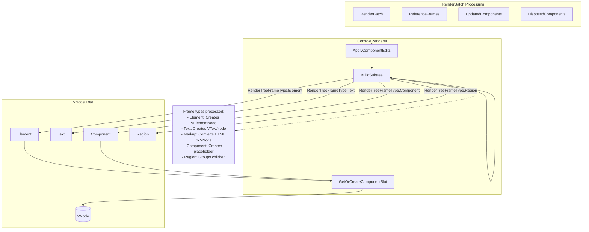
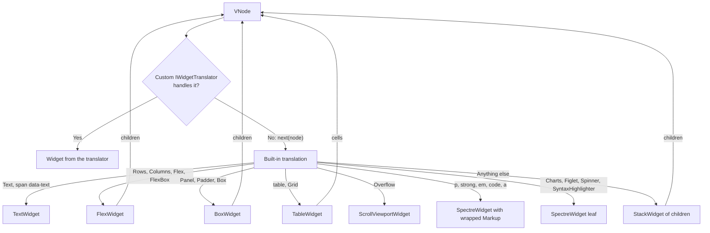
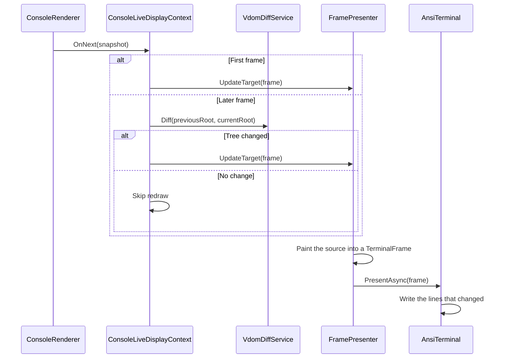
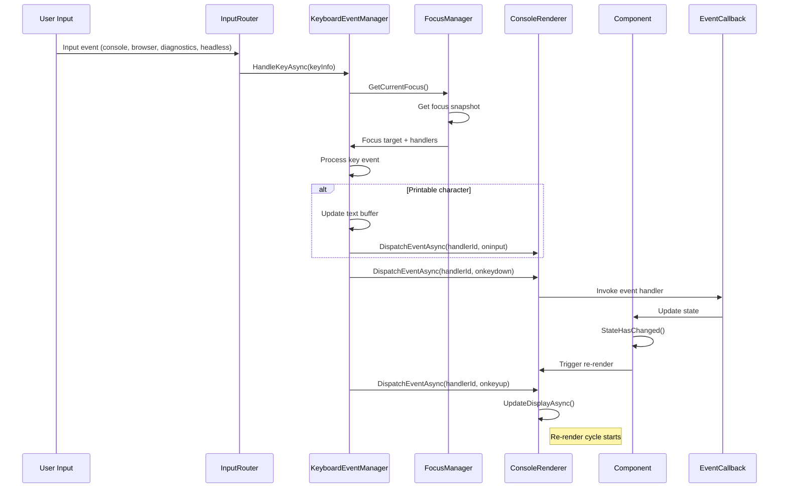

# Rendering Process

This document describes the rendering pipeline in RazorConsole, from Razor component to console output.

## Overview

RazorConsole converts Razor components into console output in these stages:

1. **Component Rendering**: Blazor renders Razor components into a `RenderBatch`.
2. **VDOM Construction**: `ConsoleRenderer` applies the batch to a `VNode` tree.
3. **Widget Translation**: `WidgetTranslationContext` translates the `VNode` tree into a `Widget` tree, running registered `IWidgetTranslator`s before the built-in translation.
4. **Layout**: `LayoutEngine` measures and arranges the widgets within the terminal viewport and records the bounds of every node.
5. **Paint**: the laid-out widgets paint into a `TerminalCanvas` of terminal cells; absolute-positioned widgets paint last, in `z-index` order.
6. **Console Output**: the live display writes the frame through Spectre.Console as ANSI escape sequences.

Before 1.0 there was also a legacy pipeline that translated `VNode`s straight to Spectre.Console `IRenderable`s through `ITranslationMiddleware`. It could not report element bounds and was removed in 1.0.

## Complete Rendering Flow

## Component Lifecycle

## VDOM Construction Process

## Widget Translation

Translators run for every node that becomes a widget, including children of built-in containers, because containers translate their children through the same `WidgetTranslationContext.Translate`. Content that a built-in element reads directly into one widget, such as the inline run inside a paragraph, does not reach translators. Animated renderables found while translating, such as spinners, are collected so the live display can refresh them on their interval. See [custom-translators.md](custom-translators.md).

## Layout and Paint

`LayoutEngine.Layout` measures the widget tree against the viewport constraints, arranges every widget into a `LayoutRect`, and grows the document to fit absolute-positioned widgets. The resulting `LayoutResult` provides:

- the layout box of every node, which feeds `IVNodeLayoutAccessor`, focus and mouse hit-testing, and the diagnostics endpoint;
- `ToFrameSource()`, a `FrameSource` that the render snapshot carries instead of a Spectre `IRenderable`. The frame loop in `FramePresenter` paints the current source into a `TerminalFrame` (a `TerminalCanvas` of cells) for every frame and presents it to an `ITerminal` backend, so animations and scrolling repaint the same source without a new render. `AnsiTerminal`, the console backend, writes frames as ANSI through `DiffRenderable` and owns the alternate screen buffer and mouse mode. `AnsiTextTerminal` renders the same ANSI as text for hosts that are not a console; the browser host's `XTermTerminal` uses it to write each frame to the component's xterm.js terminal.

`SpectreWidget` leaves render their Spectre.Console renderable at the width they were given and copy the resulting segments into the canvas cells, so Spectre-backed content takes part in layout like any other widget.

## Update Process

A terminal resize refreshes the snapshot through the same path, so the frame is laid out again at the new size. Render notifications and refreshed snapshots can arrive out of order, so the live display context never replaces a view with one from an earlier render (`FrameSource.RenderSequence`).

Every presented `TerminalFrame` carries its `FrameSource`, which records the render it belongs to (sequence, tree and layout). `ITerminalFrameObserver`s get each frame after the terminal presented it: diagnostics records it and reads the presented cells instead of painting the widgets again, and only paints a frame itself when the display has not presented that source. `HeadlessTerminal` is a backend too: it records the frames the presenter presents (writing them as ANSI as well when `CaptureAnsiOutput` is set), and presents the latest render after each input so a frame records changes the tree does not show, such as a focus move.

## Event Handling and Re-render

All input reaches the app through `InputRouter`, one event at a time and in arrival order. A console app's `ConsoleTerminalInput` reads the console and posts key, key batch and mouse events; keys that are available together (a paste) form one `KeyBatchInputEvent`, applied to a focused input as one `oninput`. The diagnostics endpoint, `HeadlessTerminal` and the browser host `Submit` events to the same router and wait until their handlers have started. Mouse events go to `MouseEventManager`.

