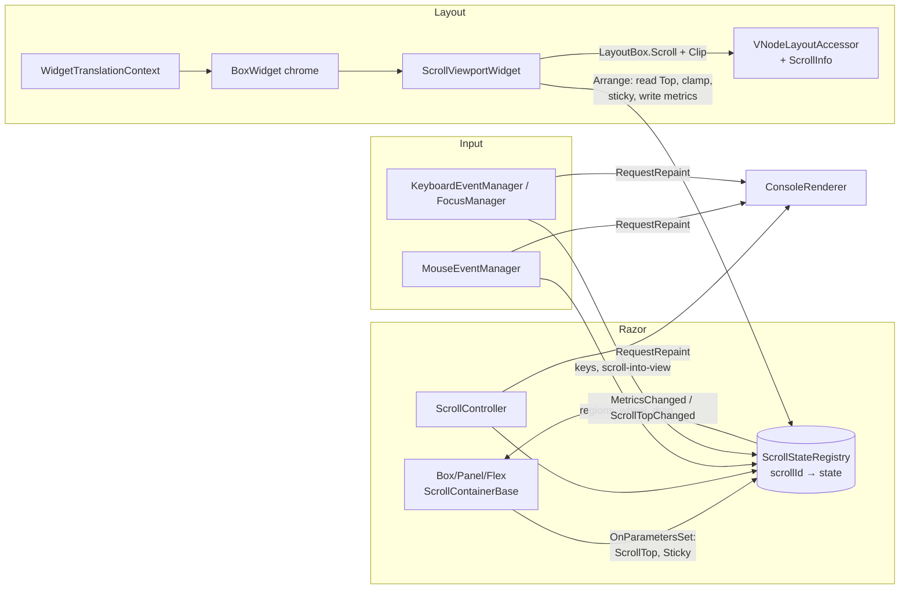

# RFC: Scrolling as a Container Property (Widget Layer)

| | |
|---|---|
| Status | Draft, open for maintainer review |
| Scope | WidgetLayout pipeline (default). LegacySpectre is covered only for compatibility. |
| Baseline | `main` @ `165c8cd`, plus branch `fix/srollable-widget-layout` @ `a539aa4` (not merged yet). Citations marked **[fix]** refer to that branch. All others refer to `main`. |
| Related | [`widget-layout-engine.md`](widget-layout-engine.md) (it already plans `BoxWidget(OverflowX/OverflowY + Scrollbar)`, see lines 157, 175-189, 255, 286-290), [`layout-box-flex.md`](layout-box-flex.md), [`keyboard-events.md`](keyboard-events.md) |

> **Note on the baseline.** The task brief says three fixes are "in this repo state": stopPropagation parsing, the bordered-box peel, and `data-fill-height` precedence. They are **not on `main`**. They exist only on `fix/srollable-widget-layout` (commits `073943c`, `098a204`, `2234970`). On `main`, `ConsoleRenderer` never passes `VNodeEventOptions`, so `@onwheel:stopPropagation` is silently ignored (`src/RazorConsole.Core/Vdom/VNode.cs:119-127`, and no caller passes options). This RFC treats that branch as a prerequisite (Phase 0).

---

## 1. Summary

Scrolling today comes from two components that solve different problems:

- `Scrollable<TItem>` is a **paginator**. It slices `Items` in Razor.
- `ViewHeightScrollable` is a **line viewport**. It crops measured content in the widget layer.

Both rely on a widget (`ScrollableWidget`) that has no input behaviour of its own. Their scrollbar cannot be clicked or dragged, and it does not render at all in the default `IsScrollbarEmbedded=true` mode.

**Recommendation.** Adopt the proposed direction, with four corrections that the code requires:

1. **The engine owns scroll state, not Razor.** Keep the effective `ScrollTop` in a singleton `ScrollStateRegistry`, keyed by a per-instance scroll id. `ScrollableLayoutCoordinator` already exists for this purpose. The layout engine clamps the value, applies stick-to-bottom, and reports metrics during `Arrange`. Input managers change the value directly and request a **repaint**, not a Blazor render. `ScrollTop`/`@bind-ScrollTop` remain available as optional inputs and change notifications. This is the RazorConsole equivalent of Claude Code mutating `scrollTop` on the node. It matters even more here: a Blazor re-render of the scroll container re-executes its `ChildContent`, which is the entire scrolled subtree.
2. **Scroll behaviour (wheel, keys, scrollbar drag) lives in the input layer, not in Razor handlers.** Blazor's `stopPropagation` is a static attribute, so a Razor handler cannot say "stop only if I consumed the scroll". The engine can, because it knows `maxScrollTop`. Razor `@onwheel` handlers still run first and can opt out with `@onwheel:preventDefault`.
3. **The scrollbar is a hit region published by layout, not a VNode.** `LayoutBox` gains scroll metadata: viewport, track and thumb rectangles. `MouseEventManager` checks these regions before the VNode hit test. Pointer capture for thumb drag reuses the existing capture model.
4. **The imperative API is a `ScrollController` passed as a parameter, rather than `@ref` methods on every container.** Panel → Box → div forwarding makes `@ref` methods awkward to expose on Panel, Border, Box, Flex, Rows and Columns. A controller object works the same way on all of them. A thin `<ScrollView>` component adds `@ref` convenience on top.

There is one internal widget, `ScrollViewportWidget` (extracted from `ScrollableWidget`'s `cropLines` path). Container translators wrap their *content* in it. A bordered `BoxWidget` paints the scrollbar over its own right border. This is the fix-branch "peel" done by construction, without the VNode/widget parent inversion the peel introduces (§3.2).

---

## 2. Current state

### 2.1 Pipeline recap

`ConsoleRenderer.CreateSnapshot` (`src/RazorConsole.Core/Rendering/ConsoleRenderer.cs:480`) runs on every render batch (`:150-198`, snapshot at `:182`). It also runs on every mouse event, because `MouseEventManager.HandleAsync` calls `renderer.RefreshSnapshot()` (`src/RazorConsole.Core/Input/MouseEventManager.cs:22`) and any-motion tracking `?1003h` is enabled (`src/RazorConsole.Core/Rendering/LiveDisplayCanvas.cs:131`). Each snapshot does the following:

1. It re-translates the **whole** VNode tree into a fresh, immutable widget tree (`WidgetTranslationContext.Translate`, `src/RazorConsole.Core/Layout/WidgetTranslationContext.cs:39-52`).
2. It runs a full measure and arrange (`LayoutEngine.Layout`, `src/RazorConsole.Core/Layout/LayoutEngine.cs:9-31`).
3. It publishes `LayoutBox` rectangles to `VNodeLayoutAccessor` (`ConsoleRenderer.cs:522-536`).
4. It paints lazily into a `TerminalCanvas` when the renderable is rendered (`src/RazorConsole.Core/Layout/WidgetCanvasRenderable.cs:24-31`).

Consequence: **widgets hold no state between frames.** Anything that must persist, such as scroll offset or thumb-drag state, has to live in a registry keyed by a stable id. The existing pattern is `data-scroll-id` + `ScrollableLayoutCoordinator`, and `data-focus-key` for focus.

### 2.2 Limitations found

| # | Limitation | Evidence |
|---|---|---|
| L1 | No scrollbar at all with `IsScrollbarEmbedded=true` (the default). `HasScrollbar` requires `!EnableEmbedded`. Embedded-in-border rendering exists only in the legacy `ScrollableRenderable`. | `Layout/ScrollableWidget.cs:156`; `Components/ViewHeightScrollable.razor:75`; legacy `Renderables/ScrollableRenderable.cs:41-43, 120-168, 281-352` |
| L2 | The scrollbar is not interactive. The `<div data-scrollbar>` node that carries `@onkeydown`/`@onfocusin` is **removed from the widget tree**, so it has no layout bounds and the mouse hit test can never reach it. It is reachable only with Tab. | `WidgetTranslationContext.cs:458-463` (`!IsScrollbarNode`), `MouseEventManager.cs:108-126` |
| L3 | A stray tab stop. `<view-height-scrollable>` / `<scrollable>` carry `@onwheel` and no `data-focusable`. `FocusManager.IsFocusable` treats *any* element with events as focusable, so every scroll component adds a tab stop that handles no keys, in addition to the scrollbar div. (Found by reading the code. Worth a test.) | `Focus/FocusManager.cs:445-463`; `ViewHeightScrollable.razor:8-9`; `Scrollable.razor:7-8` |
| L4 | `stopPropagation` is ignored on `main`. **[fix]** parses it, but the flag is still static: a nested scroller at its boundary cannot let the wheel chain to its parent. | `MouseEventManager.cs:101-104`; **[fix]** `ConsoleRenderer.cs:773-800` |
| L5 | Scroll limits lag one frame. Razor handlers clamp against `GetMaxOffset`, which returns `int.MaxValue` until the first layout has reported. The parameter value is never clamped by the engine. | `Rendering/ScrollableLayoutCoordinator.cs:19`; `ViewHeightScrollable.razor:81, 111` |
| L6 | The thumb uses the **unclamped** `Offset`, and the scrollbar is painted outside the clip. If `Offset > MaxOffset`, the thumb is drawn past the track. | `ScrollableWidget.cs:149-153, 179` (compare `:124`, which clamps for arrange only) |
| L7 | `FillHeight` inside a scroller is unbounded. Content is measured with `MaxHeight = int.MaxValue/4`, so a child that fills height measures to about 536M rows. Examples: `Panel FillHeight`, `Flex FillHeight`, `Rows Expand`. | `ScrollableWidget.cs:112`; `BoxWidget.cs:201`; `FlexWidget.cs:117`; `StackWidget.cs:61` |
| L8 | The non-embedded side scrollbar always reserves 2 columns in measure, even when nothing overflows. The arrange step then uses `HasScrollbar`, so measure and arrange can disagree. | `ScrollableWidget.cs:109-110` vs `:126` |
| L9 | **[fix]** The "peel" inverts parenthood. The widget tree becomes `Box(panelId){ ScrollableWidget(vhsId){…} }`, while in the VNode tree the panel is a *child* of the scrollable. `EnumerateLayoutParentIds` then reports inverted layout parents, and the wheel over the border or title misses the scroller, because the scroller's bounds are only the inner viewport. | **[fix]** `WidgetTranslationContext.cs:174-196`; `LayoutEngine.cs:72-77, 91-98`; `VNodeLayoutAccessor.cs:330-339` |
| L10 | `Scrollable<TItem>` is not scrolling. It slices `Items.Skip(offset).Take(PageSize)` in Razor. The widget only draws an item-count thumb. | `Scrollable.razor:106-109` (file lines), `WidgetTranslationContext.cs:140-163` |
| L11 | In legacy, `LinesToRender=0` uses `Console.WindowHeight`, which is wrong in WASM, the website and tests. | `Rendering/Translation/Translators/ViewHeightScrollableTranslator.cs:42-44` |
| L12 | Scrolling has been re-implemented ad hoc at least three times: TextArea's row window plus drag autoscroll, Htop's per-cell VNode scrollbar with drag, and the Gallery NavBar wheel and keys. | `Components/TextArea.razor:101-106, 202-231`; `gallery/RazorConsole.Htop/Components/App.razor:14, 51-53, 607-640`; `gallery/RazorConsole.Gallery/Components/NavBar.razor:5` |

---

## 3. Answers to the questions

### Q1. Native widgets vs `SpectreWidget` leaves; who owns the border

The routing is in `WidgetTranslationContext.TranslateElement` (`:54-337`). **Important:** `TryCreateSpectreFallbackWidget` runs *before* the class-based branches (`:133-136`). Whatever `ShouldUseSpectreFallback` (`:376-409`) matches becomes an opaque leaf.

| Component | Emits | Widget | Ref |
|---|---|---|---|
| `Box` | `<div data-layout="box">` | **`BoxWidget`** | `Components/Box.razor:9-25`; translator `:304-334` |
| `Panel` | `<Box Class="panel">` | **`BoxWidget`** (default Square border, padding `1,0,1,0`, title) | `Panel.razor:6`; `:272-302` |
| `Border` | `<Panel …>` | **`BoxWidget`** | `Border.razor:7` |
| `Padder` | `<Box Class="padder">` | **`BoxWidget`** (padding/margin, no border) | `:238-256` |
| `Align` | `<Box Class="align">` | **`AlignWidget`** | `:258-270` |
| `Rows` | `<Flex Class="rows">` | **`FlexWidget(Column)`** | `:191-202` |
| `Columns` | `<Flex Class="columns">` | **`FlexWidget(Row, gap 1, Stretch)`** | `:204-217` |
| `Flex` | `<div data-layout="flex">` | **`FlexWidget`** | `:219-236` |
| `FlexBox` | `<Flex Class="flexbox">` | **`SpectreWidget`** leaf (legacy `FlexBoxRenderable`) | `FlexBox.razor:7`; fallback `:384-389` |
| `Grid` | `<div class="grid">` | **`SpectreWidget`** leaf | `Grid.razor:8`; `:384-389` |
| `SpectreTable` / `<table>` | `<table class="table">` | **`TableWidget`** (separate `HeaderRows`/`BodyRows`) | `:59-62, 770-796`; `Layout/TableWidget.cs:41-53, 92-116` |
| `Markup` | `<span data-text>` | **`TextWidget`** | `Markup.razor:8`; `:79-88` |
| `Markdown` | raw HTML (`MarkupString`) | Mixed. `h1-6` → `TextWidget`, `ul/ol` → `StackWidget` of text, `blockquote` → `BoxWidget`, `hr` → `RuleWidget`, `table` → `TableWidget`, `pre` → `SpectreWidget` (syntax), `p`/inline → **`SpectreWidget`** leaves | `Markdown.razor:7`; `:100-131, 401, 419-438, 560-604` |
| `TextInput` | `<div class="text-input">` wrapping `Box` + `Flex` + `Markup` | Native (`StackWidget` > `BoxWidget` > `FlexWidget` > `TextWidget`) | `TextInput.razor:15-35` |
| `Select` | `<div>` + `<Rows>` of `<div><Markup>` | Native (`StackWidget` > `FlexWidget` > …) | `Select.razor:8-25` |

**Border ownership.** `BoxWidget` owns borders, padding, margin, title, explicit size and fill (`Layout/BoxWidget.cs`):

- **Measure** (`:178-205`) deflates constraints by margin + border thickness (0 or 1 per side) + padding, then measures the single child. Width and height come from `Width`/`Height`, from `FillWidth`/`FillHeight` (taking `constraints.Max*`), or from content + insets. The title widens the box to `title + 4`.
- **Arrange** (`:207-221`) places the child at the content origin. The child gets the full inner size if it has `data-fill-*` (or `data-expand`), otherwise `min(desired, available)`.
- **Paint** (`:223-233`) paints the border (`:242-281`: edges with `Fill`, then corners, then the title on the top edge at `x+2`, `:306-315`) **before** the child. Nothing paints after the child, so there is no hook for an "over the border" scrollbar today.

**[fix]** adds `HasBorder` and `WithChild` to support the peel.

**Implications for scrolling:**

- Any container that maps to `BoxWidget` or `FlexWidget` can host `Overflow`.
- `FlexBox` and `Grid` cannot host a scroll container *inside* them, and nothing interactive inside them is hit-testable either. Their children have no `LayoutBox`, so `Hit` returns the leaf itself (`MouseEventManager.cs:117-125`). Porting `FlexBox` to `FlexWidget` is already planned (`widget-layout-engine.md:185`). It becomes a prerequisite for "scroll anywhere".
- Prose in `Markdown` (`<p>`) is a Spectre leaf. That is fine as scroll *content*: a leaf is clipped like any other widget.

### Q2. ScrollableWidget, its translator branches, and the Razor components

**`ScrollableWidget`** (`Layout/ScrollableWidget.cs`) has two modes:

- **Paging mode** (`cropLines:false`, from `<scrollable>`): the child is laid out normally, and the scrollbar thumb is computed from `ItemsCount` and `PageSize` (`:165-177`). Razor has already sliced the items.
- **Crop mode** (`cropLines:true`, from `<view-height-scrollable>`):
  - Measure: the child is measured with height `int.MaxValue/4` (`:111-112`). `ContentHeight` and the page size are stored (`:115-116`). Height is `min(content, page)` (`:117`).
  - Arrange: the offset is clamped and `MaxOffset` is reported to the coordinator (`:124-125`). The child is arranged at `bounds.Y - offset` with height `max(content, viewport+offset)` (`:127-129`). With `AutoPageSize` (`LinesToRender=0`), the page size comes from the arranged height (`:123, 160-161`).
  - Paint: inside `PushClip(Bounds)` (`:136`), then a 1-column track and thumb at `Bounds.Right-1` (`:149-153`).

**Translator branches** (`WidgetTranslationContext.cs`):

- `<scrollable>` (`:140-163`): without a scrollbar child it degrades to a `StackWidget`. Otherwise it builds a paging-mode widget.
- `<view-height-scrollable>` (`:165-189`): builds a crop-mode widget, with `showScrollbar` only if a `data-scrollbar` child exists. **[fix]** peels a bordered `BoxWidget` child into the outer frame (`:174-196`).
- Scrollbar children are filtered out of translation (`:461`). Style attributes are read from that node (`:156-160, 177-181`).

**Components:**

- `ViewHeightScrollable.razor`: `@onwheel` + static `stopPropagation` (`:9`). Offset, lines and embedded flag go out as `data-*` (`:10-13`). A focusable scrollbar div holds key and focus handlers (`:17-25`). Keys (`:79-107`) and wheel (`:109-117`) clamp against `LayoutCoordinator.GetMaxOffset` and raise `ScrollOffsetChanged`. `ScrollContext(KeyDownEventHandler, CurrentOffset)` is passed to the child content (`:29, 142`).
- `Scrollable.razor`: the same shape, but the parameter setter clamps against `Items.Count - PageSize` (`:77-81`), it slices `VisibleItems` (`:106`), and it exposes `ScrollContext<T>(Items, KeyDownEventHandler, CurrentOffset, PagesCount)` (`:172-191`).

**Reusable:**

| Piece | Reuse? |
|---|---|
| Clip via `PushClip(Bounds)` and offset via arrange at `Y - offset` | **Yes.** This is the core of `ScrollViewportWidget`. |
| Arrange-time viewport resolution (`AutoPageSize`) and clamping | **Yes.** It becomes the *only* mode. The viewport height always comes from arranged bounds. |
| Reporting to `ScrollableLayoutCoordinator` from `Arrange` | **Yes, extended.** It becomes `ScrollStateRegistry` (stores the offset as well as max, viewport, content and sticky). |
| `CalculateThumb` | **Yes**, fixed to use the clamped offset (L6), and extracted into a shared `ScrollbarGeometry` used by both the Box (border) and the viewport (inset). |
| `ScrollbarSettings` (chars, colors, focused colors, `MinThumbHeight`, focus callbacks) | **Yes.** Add `Placement` and `Visibility`. The focus callbacks stay. |
| Paging mode (`ItemsCount`/`PageSize`), `EnableEmbedded` flag, 2-column reservation | **No.** Kept only behind the obsolete components. |
| Legacy `ScrollableRenderable` segment injection (string-searching table border glyphs) | **No.** Too fragile. Legacy-only. |

### Q3. Canvas clipping and offsets

- **Clipping: yes, nested.** `TerminalCanvas` keeps a `_clipStack`. `PushClip` intersects with the current clip and the canvas (`Layout/TerminalCanvas.cs:13, 159-164`). `Fill`, `Write` and `WriteSegments` honour it (`:55, 74-84, 108-153`). Nested scroll containers therefore clip correctly with no new canvas work.
- **Translation: none, and none needed.** Coordinates are absolute, and the offset is applied by arranging the child at a negative relative Y (`ScrollableWidget.cs:127`). `LayoutRect` allows negative X and Y (`Geometry.cs:44-60` only validates the size). This is simpler than a transform stack, because layout reruns every frame anyway.

**Missing for nested scroll containers:**

1. **Visible bounds in layout output.** `LayoutBox` carries only logical `Bounds`, and `ToLayoutInfo` ignores its `isVisible` argument (`Widget.cs:219-236`, `LayoutEngine.cs:67-70`). Hit-testing currently clips "by accident": it prunes on ancestor VNode bounds (`MouseEventManager.cs:110-115`). That only works while the scroll VNode's own bounds equal the viewport. It breaks once the viewport is a synthetic child of a bordered Box, or a scroller's VNode has no layout entry. → Add a `Clip` (visible rect) to `LayoutBox`, computed top-down in `CreateLayoutBox`, and hit-test against it. This was already anticipated in `widget-layout-engine.md:255, 356`.
2. **Overlays escape clips.** Absolute widgets are deferred and painted after the tree, with an empty clip stack (`Widget.cs:97-100`, `:198-216`). For popups this is desirable. Hit-testing still prunes them by the scroller's bounds, though, which is inconsistent. → Overlay `LayoutBox`es should get `Clip = document`.
3. **Paint culling.** Every child of a long list is painted and then discarded by the clip. → Skip children whose bounds do not intersect the current clip (`PaintContext` needs a `CurrentClip` accessor).
4. **Scrollbar paint after the child** in `BoxWidget` (see Q1).

### Q4. Mouse and input: hit testing, wheel, click, drag

- **Decoding.** The SGR mouse protocol uses any-motion tracking (`?1003h ?1006h`, `LiveDisplayCanvas.cs:131`). `SgrMouseParser` produces `Down/Up/Move/Wheel`. The wheel `DeltaY` is ±3 (`Input/TerminalMouseEvent.cs:47`).
- **Hit test.** `Hit` walks the **VNode** tree (`MouseEventManager.cs:108-126`):
  - A node *with* layout bounds that does not contain the point is pruned.
  - Children are tried in reverse z-order.
  - A node *without* bounds (component regions, filtered nodes, children of Spectre leaves) does not prune, but cannot be the target either.
  - Bounds come from `IVNodeLayoutAccessor` (`Vdom/VNodeLayoutAccessor.cs:126`), which is populated from `LayoutBox`. **Only widgets whose `VNodeId` equals a real VNode id are targetable.**
- **Dispatch.** The path is built from root to target, filtered to nodes that have a handler for that event name, and invoked deepest-first. It stops if `Options.StopPropagation` is set (`:83-106`). `WheelEventArgs` uses `DeltaMode=1`, and `OffsetX/Y` are relative to the handler node (`:89-94`).
- **Click.** Synthesized on `Up` when the button is 0, the pointer has not moved, and the target is the same node that received `Down` (`:71-80`).
- **Focus on press.** The nearest ancestor with `data-focus-key` receives focus (`:58-69`).
- **Drag with pointer capture: yes.** On `Down`, `_capturedId` is the outermost ancestor with `onmousedown` (`:43`, comment `:42`). `Move` and `Up` then go to the captured node even outside its rectangle (`:35-36`), and negative or overflowing `OffsetY` reaches it. `TextArea` relies on this for drag autoscroll (`TextArea.razor:202-214`). Htop builds a draggable scrollbar out of one `Markup` VNode per track cell (`Htop/App.razor:51-53, 611-640`).
- **Can a non-VNode region receive events?** **No.** The scrollbar is painted by a widget and has no VNode. The `data-scrollbar` div is deliberately excluded from layout (L2).

**What is needed:**

1. **Publish hit regions from layout.** `LayoutBox` gets optional `ScrollInfo { ScrollId, Viewport, Track, Thumb, Metrics }`.
2. **Check regions first in `MouseEventManager`.** If the topmost visible region contains the point, handle it natively:
   - Track click pages by ±viewport.
   - Thumb `Down` starts an *engine capture* (`_scrollDrag = (scrollId, startY, startTop)`). It is separate from `_capturedId`, so it works without any Razor handler. `Move` maps ΔY to Δtop via `(content − viewport) / (track − thumb)`. `Up` releases.
   - Hover over the thumb or track can set a registry flag for styling.
3. **Wheel default action.** First dispatch Razor `onwheel` handlers as today. Then, unless a handler on the path had `preventDefault` (parsed by **[fix]**), walk the hit path deepest-first and scroll the first scroll container that **can** move in that direction. With `OverscrollBehavior=Contain`, stop at that container even if it cannot move.
4. Hit-test against `Clip` instead of logical bounds (Q3.1).

Making the thumb a VNode element (Htop's approach) is rejected for the core. It needs one element per track cell, re-renders through Blazor on every drag step, and pollutes `ChildContent` (§5, option E).

### Q5. Focus and keyboard routing

- Keys go **only to the focused target**, with no bubbling (`Input/KeyboardEventManager.cs:146-185`).
- After `onkeydown`, focus traversal and default actions are skipped if the target is `data-input-managed` or the handler set `Handled` (`:156-163`). `Handled` lives on the **internal** `TerminalKeyboardEventArgs` (`:16-19`). Only `TextArea` sets it (`TextArea.razor:252`).
- `Select` consumes the arrow keys in `OnKeyDown` (`Select.razor:209`) but cannot mark them handled. `TextInput` consumes text through `oninput` buffers and does not use arrows or PageUp/PageDown.
- **Focusability.** `data-focusable` decides, and otherwise any element with events is focusable (`FocusManager.cs:445-463`). See L3.

**Proposed rules** (they mirror browser behaviour):

1. A scroll container with `Overflow=Scroll` is focusable by default: `data-focusable="true"` and its own `data-focus-key`, with opt-out via `Focusable="false"`. When it is focused, ↑/↓ scroll by 1, PgUp/PgDn/Space by the viewport, Home/End to the edges. The handling is native: `KeyboardEventManager` looks up `ScrollInfo` by the focused VNode id.
2. When a **descendant** is focused, run its `onkeydown` first. If the key is not handled and the target is not `data-input-managed`, PgUp/PgDn (and Ctrl+Home/Ctrl+End) **bubble** to the nearest ancestor scroll container. Arrows never bubble, because `Select` uses them and cannot mark them handled today. Making `Handled` public (for example a `KeyboardEventArgs.SetHandled()` extension, or honouring `@onkeydown:preventDefault`) is a separate, compatible improvement.
3. **Scroll into view on focus change.** When `FocusManager` moves focus to a node whose `Clip` is smaller than its bounds, adjust each ancestor scroll container by the minimal delta. Without this, Tab-ing through a form inside a scroll panel is broken. This is the most important keyboard feature, and neither existing component has it.
4. The obsolete `ViewHeightScrollable` keeps its `ScrollContext.KeyDownEventHandler` so that existing manual wiring still works.

### Q6. Where `ScrollTop` lives; how metrics reach Razor

There are three options:

| Option | Mechanics | Cost per wheel tick | Consumed-aware? |
|---|---|---|---|
| **A. Component parameter** (today) | The handler updates the parameter and Blazor re-renders. The engine clamps and reports max back through the coordinator. | A Blazor render of the container. Because the container re-renders, its `ChildContent` fragment re-executes, so the **whole scrolled subtree** is re-diffed. Then a full translate, layout and paint. | No. Stop is static, and max is one frame late (L5). |
| **B. Widget state** | — | — | **Impossible.** Widgets are rebuilt on every snapshot (§2.1). |
| **C. Engine registry (recommended)** | `ScrollStateRegistry[scrollId]` holds `{Top, Sticky, Viewport, Content, Max, Version}`. `ScrollViewportWidget.Arrange` reads `Top`, applies sticky (`Top = Max` if it was at the bottom and content grew), clamps, and writes metrics back. Input changes `Top` and calls `renderer.RequestRepaint()`. | A translate, layout and paint only. No Blazor diff. | **Yes.** The current `Max` is known synchronously, so wheel chaining and `stopPropagation`-if-consumed come for free. |

**The Claude Code trade-off.** `ScrollBox` mutates `scrollTop` on the DOM node and schedules an Ink repaint, bypassing React reconciliation, because re-rendering a long transcript on every wheel tick is expensive. The same reasoning applies here, more strongly, because of the `ChildContent` re-execution described in option A. The cost is the same as in Claude Code: React/Blazor no longer holds the source of truth, so binding must be reconciled. Proposed contract:

- **`ScrollTop` is semi-controlled.** In `OnParametersSet`, the container writes `ScrollTop` into the registry **only if it differs from the last value the component wrote or observed**. A parent re-render that passes a stale value therefore does not reset the user's scroll position.
- **`ScrollTopChanged`** is raised *after* layout, coalesced to one call per frame. The registry raises an event, and the component calls `InvokeAsync(() => ScrollTopChanged.InvokeAsync(top))`. Binding opts the user into option A's cost. Not binding keeps the fast path.
- **Metrics** (`ContentHeight`, `ViewportHeight`, `MaxScrollTop`, `IsAtTop`, `IsAtBottom`) are exposed through `ScrollController.Metrics` and a `MetricsChanged` event, raised only when they change, so no render loop is possible. This is the "layout accessor" route. It does not reuse `IVNodeLayoutAccessor`, which is keyed by VNode or hook and carries only rectangles.
- **Repaint path.** Add an internal `ConsoleRenderer.RequestRepaint()` that runs `CreateSnapshot()` + `EnqueueObserverNotification` on the dispatcher, coalesced. This is the same idea as `ConsoleLiveDisplayContext.HandleTerminalResize` (`Rendering/ConsoleLiveDisplayContext.cs:120-137`), but pushed through observers so that diffing and animation bookkeeping stay consistent.
- **Thread safety.** Input runs off the dispatcher. Mutate the registry under a lock or on `Dispatcher.InvokeAsync`. Layout reads it on the dispatcher.

### Q7. Performance

- Today, every render batch and every mouse event, including each `Move` under `?1003h`, re-translates and re-lays out the full tree (§2.1). A scroll container measures all of its content: `TextWidget` wraps every line. `SpectreWidget` renders its `IRenderable` twice, once in measure and once in paint, and paints all lines of its bounds before the clip discards them (`Layout/SpectreWidget.cs:24-60`). Cost is **O(total content)** per frame, not O(viewport).
- **Option C removes the Blazor diff** from scrolling. It does not remove the layout cost.

**Cheap wins**, in order:

1. Paint culling against the clip (Q3.3).
2. Skip `RefreshSnapshot` for `Move` events when no hover, capture or drag consumer exists.
3. Coalesce repaints for wheel bursts.

**Virtualization hooks (later):**

- `ScrollViewportWidget` accepts an optional **virtual extent**: `ContentHeightHint` plus `ContentOriginOffset`. A data-level `VirtualList<TItem>` can then render only `[first … first + viewport + overscan)` items as VNodes, inside a spacer of `count × itemHeight`. The scrollbar and clamping use the hint instead of measuring.
- This is the natural successor of `Scrollable<TItem>`'s slicing (L10). It reads `Top` from the registry and re-renders only when the *window* changes, not on every tick.
- Blazor's built-in `Virtualize` depends on JS `IntersectionObserver` and is not usable here.
- Measure caching keyed by VNode id + width + content version would come after this. It needs dirty tracking in `ConsoleRenderer`, and is out of scope.

### Q8. Legacy pipeline

LegacySpectre translates VNodes to Spectre renderables. `ScrollableTranslator`/`ViewHeightScrollableTranslator` and `ScrollableRenderable` stay there for the obsolete components. For the **new** API:

- The new attributes (`data-overflow-y`, `data-scroll-id`, …) are ignored by the legacy Box/Panel/Flex translators, so content renders **unclipped**. This is equivalent to `Overflow=Visible`. Input on the region does nothing, because there is no `ScrollInfo` in legacy snapshots, which have no layouts (`ConsoleRenderer.cs:511`).
- **Recommendation: officially unsupported (no-op) in LegacySpectre.** Log a single warning the first time `Overflow != Visible` is seen. `widget-layout-engine.md:295` plans to keep legacy "for one release". Porting interactivity and border scrollbars there would mean more segment-injection hacks (L1).
- **Alternative**, if the maintainer wants a minimal fallback: map `Overflow=Hidden|Scroll` with a known `Height` onto the existing `ScrollableRenderable(cropLines:true)` with a side scrollbar. This gives a static viewport only.

### Q9. Usage inventory (migration size)

Counts are lines that match `Scrollable|ViewHeightScrollable|ScrollableWidget|ScrollbarSettings|IsScrollbarEmbedded|ScrollableRenderable|ScrollableLayoutCoordinator|ScrollContext|view-height-scrollable`, from `git grep` on `main`.

| Area | File | Uses |
|---|---|---|
| **Core (public API)** | `Components/Scrollable.razor`, `Components/ViewHeightScrollable.razor` | Components + nested `ScrollContext` / `ScrollContext<T>` (public) |
| | `Rendering/ScrollbarSettings.cs` | Public record |
| | `Rendering/ScrollableLayoutCoordinator.cs` | Public class, DI singleton (`RazorConsoleServiceCollectionExtensions.cs:65`) |
| | `Layout/ScrollableWidget.cs` | Public sealed widget |
| | `Rendering/Translation/Translators/ScrollableTranslator.cs`, `ViewHeightScrollableTranslator.cs` | Public middlewares, registered at `RazorConsoleServiceCollectionExtensions.cs:111-112` |
| | `Renderables/ScrollableRenderable.cs`, `ScrollBarRenderable.cs` | Internal |
| | `Layout/WidgetTranslationContext.cs:140-189` | Translator branches |
| **Gallery** | `Pages/ScrollableGallery.razor` (15) | 3× `Scrollable` (Table, Panel+`ol`, markups), 1× `ViewHeightScrollable`, `context.CurrentOffset/PagesCount` |
| | `Layouts/MainLayout.razor:26` | **Whole-page** `ViewHeightScrollable LinesToRender=ContentHeight IsScrollbarEmbedded=false`. The most important real usage. |
| | `Components/NavBar.razor:44` | Route only. NavBar implements its own wheel and keys (`:5`). |
| | `gallery/RazorConsole.Htop/Components/App.razor` | Hand-rolled scrollbar and drag (would migrate to the new API) |
| **Examples** | `examples/GalleryScrollable/Components/App.razor` (15), `examples/ScrollableMinimal/Components/App.razor` (3) | Paginator with `ScrollbarSettings`, `IsScrollbarEmbedded=false` |
| | `examples/LLMAgentTUI/Components/CommandMenu.razor:9` | Own wheel handling |
| **Website** | `src/RazorConsole.Website/Components/Scrollable_1.razor`, `ViewHeightScrollable_1.razor`, `Markdown_1.razor`, `Program.cs:35-39` | Live demos |
| | `website/src/docs/built-in-components.md`, `widget-layout.md:28`, `whats-new-in-razorconsole-0-6-0.md`, `website/src/data/components.generated.ts`, `website/src/components/ui/TypeLink.tsx` | Docs and generated metadata |
| **Docs** | `README.md:99, 135, 144`; `design-doc/builtin-components.md` (11); `design-doc/widget-layout-engine.md` (7); `release-notes/v0.5.0.md` (10); `.agents/skills/razorconsole-example-alignment/SKILL.md` | |
| **Tests** | `Renderables/ScrollableRenderableTests.cs` (30), `Rendering/Translation/ScrollableTranslatorTests.cs` (5), `Layout/WidgetLayoutTests.cs:490-653` (8), `Layout/AbsolutePositionLayoutTests.cs:162`, `Integration/GallerySampleTests.cs:73, 110, 201` | |
| | **[fix]** adds `MouseEventManagerScrollPropagationTests`, `ViewHeightScrollableFrameTests`, `ScrollablePanelListReproTests` and others (~944 test lines) | |
| **Other scrolling to unify** | `Components/TextArea.razor` (internal row window, drag autoscroll) | Keep internal. It can adopt the registry later. |

**Sizing:** 2 public components, 4 public types, 2 public middlewares, about 6 sample and demo pages, about 8 docs pages, and about 6 test files. All are mechanical except `MainLayout`, which becomes `<Box Overflow=Scroll FillHeight>`.

---

## 4. Proposed design

### 4.1 Public API

New types live in `RazorConsole.Components` / `RazorConsole.Core.Rendering`:

```csharp
public enum OverflowMode { Visible, Hidden, Scroll }      // NOT "Overflow": collides with Spectre.Console.Overflow
public enum ScrollbarPlacement { Border, Inset, Outside }  // Border falls back to Inset when there is no right border
public enum ScrollbarVisibility { Auto, Always, Never }

public sealed record ScrollbarSettings   // existing record, extended (additive)
{
    // existing: TrackChar, ThumbChar, Track/Thumb(+Focused)Color, MinThumbHeight, OnFocusIn/OutCallback
    public ScrollbarPlacement Placement { get; init; } = ScrollbarPlacement.Border;
    public ScrollbarVisibility Visibility { get; init; } = ScrollbarVisibility.Auto;
}

public sealed class ScrollController
{
    public ScrollMetrics Metrics { get; }                 // Top, ContentHeight, ViewportHeight, MaxTop, IsAtTop, IsAtBottom
    public event Action<ScrollMetrics>? MetricsChanged;   // raised after layout, only on change
    public Task ScrollToAsync(int top);
    public Task ScrollByAsync(int delta);
    public Task ScrollToTopAsync();
    public Task ScrollToEndAsync();
    public Task ScrollIntoViewAsync(string hookKey);      // data-vnode-hook of a descendant
    public bool StickToBottom { get; set; }
}
```

Shared container parameters, through a base class (`@inherits ScrollContainerBase`) on `Box` and `Flex`, forwarded by `Panel`, `Border`, `Padder`, `Rows` and `Columns`:

| Parameter | Default | Notes |
|---|---|---|
| `OverflowY` (alias `Overflow`) | `Visible` | `Hidden`: clip, no bar, programmatic scroll only. `Scroll`: clip plus bar plus input. |
| `ScrollTop` / `ScrollTopChanged` | — | Semi-controlled (Q6). `@bind-ScrollTop` works. |
| `Scrollbar` | `new()` when `Scroll` | `null` hides the bar but keeps wheel and keys. |
| `StickToBottom` | `false` | Sticks while at the bottom. Scrolling up releases it, and returning to the bottom re-engages it. |
| `Controller` | — | Imperative API. |
| `Focusable` | `true` when `Scroll` | Makes the container a tab stop. |
| `OverscrollBehavior` | `Auto` | `Contain` disables wheel chaining to ancestors. |

`OverflowX` is reserved (§7, open question 6).

**Sizing rule.** A scroll container's height is its `Height`, or its `FillHeight` resolution, or `min(content + insets, constraints.MaxHeight)`. In other words, it grows until its parent limits it, then scrolls. This is CSS `max-height` semantics. It replaces `LinesToRender`. Inside the viewport, children are measured with **unbounded** height. A `FillHeight` child resolves to `max(content, viewport)` instead of infinity (fixes L7).

### 4.2 Razor examples

**Simple scroll panel**

```razor
<Panel Title="Files" Height="10" Overflow="OverflowMode.Scroll">
    @foreach (var f in _files) { <Markup Content="@f.Name" /> }
</Panel>
```

The scrollbar defaults to `Placement=Border`, so it is drawn over the panel's right border. The border and title stay fixed.

**Border scrollbar with custom styling, and a borderless fallback**

```razor
<Panel Title="Logs" FillHeight Overflow="OverflowMode.Scroll"
       Scrollbar="@(new ScrollbarSettings { ThumbChar = '┃', ThumbColor = Color.Aqua })">
    ...
</Panel>

<Box Height="8" Overflow="OverflowMode.Scroll"
     Scrollbar="@(new ScrollbarSettings { Placement = ScrollbarPlacement.Border })">
    @* no border → falls back to Inset (1 column reserved inside padding) *@
</Box>
```

**Log view with StickToBottom**

```razor
<Panel Title="Build output" FillHeight Overflow="OverflowMode.Scroll"
       StickToBottom="true" Controller="_log">
    @foreach (var line in _lines) { <Markup Content="@line" /> }
</Panel>
@if (!_log.Metrics.IsAtBottom) { <Markup Content="↓ new output (End)" /> }

@code {
    private readonly ScrollController _log = new();
    protected override void OnInitialized() => _log.MetricsChanged += _ => InvokeAsync(StateHasChanged);
}
```

**Nested scroll containers**

```razor
<Rows FillHeight Overflow="OverflowMode.Scroll">            @* page scroller *@
    <Markdown Content="@_intro" />
    <Panel Title="Inner table" Height="8" Overflow="OverflowMode.Scroll">
        <SpectreTable>...</SpectreTable>
    </Panel>                                              @* wheel chains to the page at the inner edges *@
    <Panel Title="Modal-like list" Height="6" Overflow="OverflowMode.Scroll"
           OverscrollBehavior="OverscrollBehavior.Contain"> ... </Panel>
</Rows>
```

**Programmatic scroll**

```razor
<ScrollView @ref="_view" Height="12" @bind-ScrollTop="_top"> ... </ScrollView>
<TextButton Content="Top" OnClick="() => _view.ScrollToTopAsync()" />
<TextButton Content="Find" OnClick="() => _view.ScrollIntoViewAsync(_matchHook)" />
@code { private ScrollView _view = default!; private int _top; }
```

`ScrollView` is a thin component: `<Box Overflow=Scroll Controller=_ownController …>` that exposes the controller's methods. It is the `@ref`-friendly entry point, and the right home for future scroll-specific parameters.

### 4.3 Internal design



**Translator.** The Box, Panel, Padder, Flex, Rows and Columns branches call one helper, `WrapContentIfScrolling(node, contentWidget)`:

- For a Box, it returns `BoxWidget(node.ID, chrome){ ScrollViewportWidget(node.ID + "-viewport", scrollId){ child } }`, and gives the Box a reference to its viewport for border-scrollbar painting.
- For a Flex, it returns `ScrollViewportWidget(node.ID){ FlexWidget(node.ID + "-content") }`.

The VNode id stays on the *outer* widget, so the parent relationships stay correct (fixes L9). The `-viewport`/`-content` suffix convention already exists in `ComposeChildren` (`WidgetTranslationContext.cs:465-471`). The `<view-height-scrollable>` branch is rewritten onto the same helper, and the **[fix]** peel special case is removed.

**`ScrollViewportWidget`** is extracted from `ScrollableWidget` crop mode:

- **Measure:** the child gets `BoxConstraints(0, W − insetBar, minH: fillsHeight ? viewport : 0, maxH: Unbounded)`. A new `BoxConstraints.HasBoundedHeight` lets Box/Flex/Stack resolve `Fill*` safely.
- **Arrange:** reads the registry and computes `Top`. Arranges the child at `Y − Top`. Writes metrics.
- **Paint:** inside `PushClip`, with culling. Paints the `Inset` bar.
- **`CreateLayoutBox`:** adds `ScrollInfo` and pushes `Clip` down.

`ScrollableWidget` remains, marked `[Obsolete]`, for paging mode only.

**`BoxWidget`:**

- A new optional `ScrollViewportWidget? ScrollTarget`.
- After `Child.Paint`, if `Placement == Border && Border.Right != None && overflowing`, it paints the track and thumb on column `Right − 1`, on rows `[top + borderTop, bottom − borderBottom)`, with the shared `ScrollbarGeometry`.
- The track and thumb rectangles go into `ScrollInfo`.
- `Outside` placement reserves one column to the right of the border, like a margin.

**Layout output.**

- `LayoutBox` gets `Clip` and `Scroll` (an internal record).
- `VNodeLayoutInfo` is a **public positional record struct**, so adding positional parameters would break binary compatibility. Add `VisibleBounds` as an `init`-only property instead.

**Input:**

- `MouseEventManager`:
  1. Thumb-drag capture short-circuits everything else.
  2. Otherwise, check regions top-down.
  3. Otherwise, do the VNode hit test against `Clip`.
  4. Then dispatch to Razor handlers.
  5. For the wheel, if not prevented, apply the native default action with chaining.
- `KeyboardEventManager` handles a focused scroll container natively, and lets unhandled PgUp/PgDn bubble.
- `FocusManager` raises focus-changed. A `ScrollIntoViewService` adjusts ancestors using `GetLayoutAncestorsByVNodeId` (`VNodeLayoutAccessor.cs:163-174`).

**Registry lifecycle.** The scroll id is a per-component GUID, as in `ViewHeightScrollable._scrollId` today. It is removed on `Dispose`, and `ScrollableLayoutCoordinator` becomes an obsolete facade over the registry.

---

## 5. Alternatives considered

| Option | Pros | Cons | Verdict |
|---|---|---|---|
| **A. Keep `ViewHeightScrollable` as the single primitive** (fix the embedded bar, add drag) | Smallest change. No new parameters on layout containers. | It is a wrapper around arbitrary content, so it must guess which child is "the frame" (the peel heuristic, L9). Users must nest `ViewHeightScrollable > Panel` instead of saying `Panel Overflow`. `LinesToRender` duplicates the container's sizing. It does not compose with Flex `FillHeight`. | Rejected as the end state. Kept as an `[Obsolete]` facade. |
| **B. Overflow on containers, Razor-owned state** (the brief's direction as literally written) | Familiar Blazor model. Everything is in parameters. | Every tick re-renders the scrolled subtree (Q6). No consumed-aware propagation, because stop is static. One-frame-late clamping. The thumb needs VNodes to be clickable. | Rejected for state. Kept for the *surface* (parameters, `@bind`). |
| **C. Overflow on containers, engine-owned state** (this RFC) | O(layout) per tick. Correct clamping and chaining. Border bar for free in `BoxWidget`. One widget for all containers. Matches `widget-layout-engine.md` intent. | New registry and repaint path. Semi-controlled binding semantics must be documented. More input-layer code. | **Recommended.** |
| **D. Scroll inside Spectre renderables** (extend `ScrollableRenderable`) | Works in both pipelines. | Segment-level post-processing (L1) is brittle (it searches for table border glyphs, `ScrollableRenderable.cs:364-425`). No layout bounds, so no hit regions and no nested hit testing. It fights the WidgetLayout migration. | Rejected. Legacy only. |
| **E. Scrollbar as VNode elements** (Htop approach) | No input-layer changes. Users can restyle the bar with components. | One element per cell. Every drag step goes through Blazor. It must be injected into `ChildContent`. Border placement is impossible, because a VNode cannot overlap the Box's border. | Rejected for core. Still fine for apps. |
| **F. Data-level only** (`Scrollable<TItem>` slicing / `VirtualList`) | Scales to huge lists. Cheap layout. | Only works for homogeneous item lists. Wrapped or variable-height content does not fit. | Complementary: `VirtualList` builds on C (Q7). |

---

## 6. Migration and deprecation

**Timing matters.** `Directory.Build.props` was bumped to `VersionPrefix 1.0.0` (`52200a3`), and no 1.0 release note exists yet. Deprecations are free now. Removals after 1.0 need 2.0.

| Item | Plan | Breaking? |
|---|---|---|
| `ViewHeightScrollable` | `[Obsolete("Use Overflow=\"OverflowMode.Scroll\" on Panel/Box/Rows, or <ScrollView>")]`. The translator branch is retargeted onto `ScrollViewportWidget`. `LinesToRender>0` maps to `Height`, `0` maps to fill. `ScrollOffset`/`ScrollOffsetChanged` map to the registry with semi-controlled semantics. `IsScrollbarEmbedded` maps to `Placement = Border` or `Inset`. `ScrollContext.KeyDownEventHandler` is kept. | **Behavioural only:** (1) the embedded scrollbar now actually renders (L1 fix); (2) the border and title stay fixed (already true with **[fix]**); (3) the inset bar is 1 column, not 2 (L8); (4) the stray tab stop disappears (L3). Snapshot and golden tests will change. |
| `Scrollable<TItem>` (paginator) | `[Obsolete]`, pointing to `ScrollView` for content or a future `VirtualList<TItem>` for data. Kept in core for 1.x, with no new features. Removed or moved to a samples package in 2.0. | None in 1.x. |
| `ScrollableWidget` | `[Obsolete]`. Paging mode only. | None. |
| `ScrollableLayoutCoordinator` | `[Obsolete]` facade over `ScrollStateRegistry`. It keeps its DI registration. | None. |
| `ScrollableTranslator` / `ViewHeightScrollableTranslator` | Unchanged. Legacy only. Removed together with LegacySpectre. | None. |
| `ScrollbarSettings` | Additive `Placement` and `Visibility` properties. | None. |
| `MainLayout.razor` (gallery) | `<Flex … Overflow="OverflowMode.Scroll" FillHeight>` around `@Body`. | — |
| New `Focusable` default on scroll containers | Adds a tab stop where `Overflow=Scroll` is used. Opt-out exists. | New API only. |
| `FillHeight` semantics inside a scroller | Changes from "about 536M rows" (a bug) to `max(content, viewport)`. | Bug fix. |

**Docs:** add a "Scrolling" page under `website/src/docs/`, update `built-in-components.md`, the README component list, and the `widget-layout-engine.md` mapping table (line 189). Add a migration snippet for each obsolete component.

---

## 7. Phased implementation plan

Each phase is one PR with its own tests (xUnit + Shouldly, `src/RazorConsole.Tests`).

| # | PR | Tests |
|---|---|---|
| 0 | **Land `fix/srollable-widget-layout`** (stopPropagation/preventDefault parsing, `data-fill-height` precedence, peel). | Already on the branch. |
| 1 | **Constraints:** `BoxConstraints.Unbounded`/`HasBoundedHeight`. Box/Flex/Stack `Fill*` respects it. Fix the thumb clamp (L6). | Widget: `FillHeight` child in an unbounded parent, thumb at `offset > max`. |
| 2 | **`ScrollViewportWidget`** extracted from crop mode, plus shared `ScrollbarGeometry`. `ScrollableWidget` crop mode delegates to it. | Golden canvas parity with current `ViewHeightScrollable` tests. |
| 3 | **`LayoutBox.Clip` + `VNodeLayoutInfo.VisibleBounds`**. `MouseEventManager.Hit` uses `Clip`. Paint culling. | Clipped child not hittable. Overlay inside a scroller still hittable. Culling does not change output. |
| 4 | **`ScrollStateRegistry` + `ConsoleRenderer.RequestRepaint`**. The coordinator becomes a facade. Engine-side clamp and sticky. | Registry unit tests. Repaint emits a snapshot without a Blazor render. Sticky follows content growth. |
| 5 | **`Overflow` on Box/Panel/Border/Padder** (`Inset` bar), `ScrollTop` semi-controlled, `ScrollTopChanged` coalesced. | Translator tests. Integration: a parent re-render with a stale `ScrollTop` does not reset. No render loop. |
| 6 | **Border placement** painted by `BoxWidget`, plus `Outside`. Retarget `<view-height-scrollable>`, remove the peel, honour `IsScrollbarEmbedded`. | Golden: bar on the right border, title intact, fallback to inset. Fixes the known open issue. |
| 7 | **Native wheel**: default action after Razor handlers, `preventDefault` opt-out, chaining, `OverscrollBehavior`. | Nested: inner consumes until its edge, then the outer scrolls. `Contain` stops it. `preventDefault` disables it. |
| 8 | **Scrollbar regions**: track click pages, thumb drag with engine capture, hover state. | Drag outside the track keeps scrolling. Release outside. Click versus drag. |
| 9 | **Keyboard and focus**: focusable container, keys, PgUp/PgDn bubbling, scroll-into-view on focus change. Fix L3. | A Tab through a form inside a scroller brings each field into view. `Select` arrows are not stolen. |
| 10 | **`ScrollController` + `<ScrollView>` + `StickToBottom` + `ScrollIntoViewAsync`**. | API tests, log demo. |
| 11 | **`Overflow` on Flex/Rows/Columns**. Gallery `MainLayout` migrated. | Gallery integration tests (`GallerySampleTests`). |
| 12 | **Deprecations + docs + samples** (gallery page, examples, website demos). | Build with warnings-as-errors on samples. |
| 13 | **Perf**: skip snapshots for idle `Move`, coalesce wheel. | Counters in tests. |
| 14 | *(later)* `VirtualList<TItem>` on the virtual-extent hook. | Large list (10k) renders only the window. |
| 15 | *(later)* **Tables**: `TableWidget` with a fixed header and a scrollable body. `HeaderRows`/`BodyRows` are already separate (`TableWidget.cs:51-53, 109-115`). | Header stays put. The bar sits on the body rows only. |
| 16 | *(later)* `OverflowX`, after a decision on text wrapping (open question 6). | — |

Independently of these phases, scroll containers need the native `FlexBox` port (`widget-layout-engine.md:185`) before they can sit inside `FlexBox`/`Grid`.

---

## 8. Risks

| Risk | Mitigation |
|---|---|
| **Layout cost per tick** stays O(content). Long logs may stutter on wheel bursts or when dragging the thumb. | Phase 3 culling, Phase 13 coalescing, then virtualization. Measure with Htop/Gallery before and after. |
| **Semi-controlled `ScrollTop`** surprises users ("I set 0 and nothing happened", because the value had not changed). | Document it. `Controller.ScrollToAsync` always applies. Consider a `ScrollRequest` value with a version, if needed. |
| **Render loops** through `ScrollTopChanged`/`MetricsChanged` → `StateHasChanged` → layout. | Raise only on change, coalesce per frame, never raise from within the same layout that the change caused twice. |
| **Threading.** Input threads mutate the registry while layout runs on the dispatcher. | Lock-protected immutable state records, or marshal onto `Dispatcher.InvokeAsync`. |
| **Name clash** with `Spectre.Console.Overflow` in Razor files that `@using Spectre.Console`. | Use `OverflowMode`. |
| **Focus order changes** (new tab stops, removal of L3) break gallery and integration expectations. | Ship in Phase 9 with updated snapshots. Note it in the release notes. |
| **`FlexBox`/`Grid` are Spectre leaves.** Scrollers or interactive children inside them do not work. | Document it. Prioritize the native `FlexBox` port. |
| **Pipeline divergence.** Legacy ignores `Overflow`. | Warn once. Legacy removal is already planned. |
| **The [fix] branch is not merged.** This plan depends on its event-option parsing. | Phase 0. |

## 9. Open questions for the maintainer

1. **RFC location.** The repo uses `design-doc/` (indexed in `design-doc/README.md`), not `docs/rfc/`. Should this file stay here, and should it be added to the README index?
2. **Remove or obsolete before 1.0?** Should `Scrollable<TItem>`/`ViewHeightScrollable` be `[Obsolete]` in 1.0 and removed in 2.0, or removed before 1.0 ships?
3. **Default focusability** of `Overflow=Scroll` containers: should it be `true` (browser-like and accessible) or `false` (fewer tab stops)?
4. **Should `Overflow` live on Flex/Rows/Columns at all**, or only on Box-based containers? (`widget-layout-engine.md:177` says scrollbars belong to the box layer.) The helper supports both, but the API surface doubles.
5. **Public keyboard `Handled`.** Should it be exposed (an extension method, or `@onkeydown:preventDefault` honoured as "handled")? That would let arrows bubble safely to scroll containers.
6. **`OverflowX` semantics.** Does horizontal scroll mean "no wrapping" for `TextWidget` and Spectre leaves (measure at unbounded width)? Or only clipping of intrinsically wide content?
7. **LegacySpectre.** Is a no-op plus warning acceptable, or is a minimal `ScrollableRenderable`-based static viewport wanted?
8. **`TextArea`.** Should it migrate to the registry, so it shares wheel chaining and scrollbar behaviour, or keep its specialised row window?

## Appendix A. External reference (design input only)

This summary is from prior knowledge. Nothing was fetched or verified during this research.

- **Ink `Box`** supports `overflow`, `overflowX` and `overflowY` with `visible | hidden`. It has no built-in scroll: `hidden` clips the output region. Scrolling in Ink apps is usually done by offsetting content (a negative margin or translation) inside an `overflow: hidden` box, then measuring with `measureElement`.
- **Claude Code `ScrollBox`** (per the brief): a Box with `overflow: scroll` whose content is translated by `-scrollTop` and clipped. It has imperative `scrollTo`/`scrollBy`, sticky-to-bottom, and `scrollTop` mutated on the node outside React state, followed by a repaint. This RFC adopts the same split. The engine owns the position, and the component tree is notified only optionally.
- **ink-scroll-view / ink-scroll-bar** (community): a ref-based ScrollView (scroll methods, content and viewport height getters), and a scrollbar with a mode that replaces one side of a box border. This RFC's `Placement=Border` is the equivalent. Unlike in Ink, RazorConsole's `BoxWidget` owns border painting, so the bar can be painted by the Box itself instead of by a sibling component.
