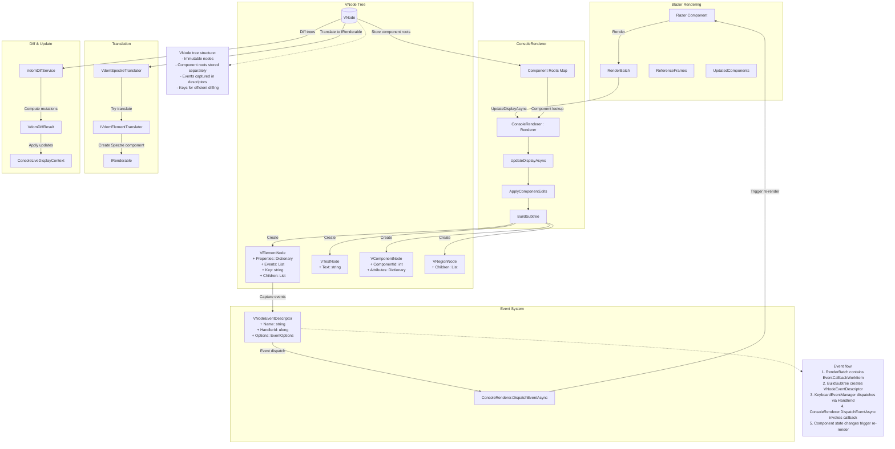

## Virtual DOM renderer redesign

> **Historical design.** This document records the move from HTML snapshots to the `VNode` tree. Its Spectre translation stages (`VdomSpectreTranslator`, `SpectreRenderableFactory`, VDOM mutations applied to the display) were replaced by widget translation and layout, and the legacy pipeline was removed in 1.0. See [rendering-process.md](rendering-process.md) for the current pipeline.

### Architecture Overview

### Goals
- Render `.razor` components straight into a virtual console tree without taking a dependency on `HtmlRenderer`.
- Preserve the Blazor event callback pipeline by deriving from `Microsoft.AspNetCore.Components.Renderer`.
- Feed the existing diff and Spectre translator stacks with richer node metadata (attributes + events) while keeping Razor authoring unchanged.

### Target pipeline (after refactor)
1. `ConsoleRenderer` (new) mounts the root Razor component and produces a `VNode` tree directly from the render batch.
2. `VNode` snapshot is passed to `SpectreRenderableFactory` to build the Spectre renderable.
3. `ConsoleViewResult` carries the VDOM plus an optional HTML snapshot (generated from the VDOM only when required for diagnostics/tests).
4. `ConsoleLiveDisplayContext` diffs successive `VNode` snapshots and drives Spectre updates.

> Reference: mirrors the approach in `RazorCliVdom.TerminalRenderer`, adapted to RazorConsole services and Spectre integration.

### Core components
- **`ConsoleRenderer : Renderer`**
	- Owns the `RendererSynchronizationContext` and integrates with DI just like `HtmlRenderer`.
	- Overrides `UpdateDisplayAsync` to translate render batches into `VNode` graphs via a dedicated builder.
	- Registers event handlers with the base renderer so `EventCallback` works end-to-end (no custom dispatcher hacks).
- **`RenderBatchVNodeBuilder`**
	- Consumes `RenderBatch.ReferenceFrames` to construct immutable `VNode` instances.
	- Collapses markup frames, propagates component keys, and captures `EventCallbackWorkItem` data into event descriptors.
- **`VNodeEventRegistry`**
	- Indexes event descriptors by sequence + frame index so the input system can dispatch back into `Renderer.DispatchEventAsync`.
	- Exposes lookup APIs for focus/input controllers without leaking renderer internals.
- **`RazorComponentRenderer` (facade)**
	- Creates a scope, resolves `ConsoleRenderer`, renders the requested component, and packages a `ConsoleViewResult`.
	- Handles parameter projection just like today.

### VNode model updates
- `VNodeKind` retains `Element` and `Text`; we add `ComponentPlaceholder` if we ever need to expose unrendered components.
- `VElementNode` gains:
	- `IReadOnlyDictionary<string, VPropertyValue> Properties` — wraps strings, booleans, numbers, and `MarkupString` without lossy casting.
	- `IReadOnlyList<VNodeEventDescriptor> Events` — captures event name, renderer-assigned handler ID, and modifiers (prevent default, stop propagation).
	- `Key` remains for diffing.
- `VTextNode` remains unchanged besides storing text as-is.

### Event callback flow
1. When the render batch contains an attribute whose value is an `EventCallbackWorkItem`, `RenderBatchVNodeBuilder` emits a `VNodeEventDescriptor`.
2. The descriptor registers with `VNodeEventRegistry`, which stores the handler delegate and the owning renderer component ID.
3. Console input adapters resolve descriptors (via `FocusManager` or other controllers) and forward events into `ConsoleRenderer.DispatchEventAsync`.
4. Base `Renderer` schedules the callback on the dispatcher, so state updates re-render through the same pipeline.

### ConsoleViewResult adjustments
- `ConsoleViewResult` exposes the new `VNode` snapshot publicly (read-only) so consumers no longer rely on HTML.
- `Html` becomes optional: the renderer populates it on demand using a lightweight VDOM-to-markup serializer for tests that assert markup.
- Animated renderable management stays the same.

### Diff & translation impacts
- `VdomDiffService` compares `VPropertyValue` instances instead of raw strings; equality falls back to `Equals` with invariant string comparison for textual values.
- Structural diff logic is otherwise unchanged, but mutations may carry updated property dictionaries and event lists.
- `VdomSpectreTranslator` now receives fully-typed properties (e.g., numbers for padding) and can read event descriptors when emitters need to register focusable controls.

### Error handling & diagnostics
- `ConsoleRenderer.HandleException` forwards to an injectable `ILogger` and rethrows for catastrophic failures.
- Unmatched frame types (e.g., `Markup` when not expected) produce diagnostic nodes that render as plain text to avoid hard crashes.
- A development flag enables dumping the generated VDOM for troubleshooting.

### Testing strategy
- Unit tests for `RenderBatchVNodeBuilder` covering attributes, keys, conditional rendering, and event descriptor capture.
- Integration tests for `ConsoleRenderer` verifying that button clicks trigger `EventCallback` and re-render.
- Regression tests to ensure HTML serialization (when requested) matches legacy expectations.
- Existing VDOM diff and translator suites run unchanged but updated to new property types.

### Risks & mitigations
- **Event dispatch regressions**: Mitigate with focused tests mirroring `RazorCliVdom` scenarios.
- **Performance**: Avoid allocations by reusing builders per render batch and pooling dictionaries.
- **Backward compatibility**: Phase out direct HTML comparisons by gradually migrating tests to VDOM assertions, keeping HTML serializer as a fallback during transition.

### Follow-up work
- Wire `VNodeEventRegistry` into the focus/input pipeline so keyboard navigation can trigger component callbacks.
- Expose developer diagnostics (`consoleRenderer.ExportCurrentTree()`) for the gallery app.
- Evaluate sharing the renderer with `RazorCliVdom` to reduce duplication once both repos stabilize.
